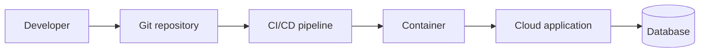

# The Insecure Architecture

A hands-on team challenge from **Securing the Cloud Delivery Pipeline: From IAM to Security Gates**.

Every team gets the same system. It builds and it deploys. It is also badly unsafe.
**Eight flaws are planted across this repository.** Your job is to find them, classify them, fix them, and decide whether this system should ever reach production.



---

## Your mission

| Step | What you do |
|---|---|
| **1 · Identify** | Find all eight flaws. Point to the exact file and line. |
| **2 · Classify** | Label each one as a missing **sensor**, **constraint** or **actuation**. |
| **3 · Fix** | Change the code so the flaw is gone and the system still works. |
| **4 · Decide** | Apply the gate rules below. Would you let this deploy to production? |

Record steps 1, 2 and 4 in [`DECISION.md`](DECISION.md). Step 3 is your commits.

## Gate rules

Run them in order. The first rule that applies decides.

1. If the application has any **critical unpatched vulnerability**, do not deploy.
2. If any IAM policy grants **full administrative access to everything**, do not deploy.
3. If **sensitive data is reachable from the public internet**, do not deploy.
4. If the overall risk is **high** but no rule above is broken, **escalate** to the security team.
5. Otherwise, **approve** the deployment.

---

## How to play

```bash
git clone https://github.com/<owner>/<this-repo>.git
cd <this-repo>
git checkout -b team/<your-team-name>      # lowercase letters, digits, hyphens

# find, fix, fill in DECISION.md ...

git add -A
git commit -m "fix: scope the deploy role"
git push -u origin team/<your-team-name>
```

Every push to your `team/...` branch is scored automatically.

- **Your detailed result:** the **Actions** tab, workflow **score**, the newest run for your branch.
- **The live leaderboard:** the GitHub Pages site for this repo (your instructor will share the link).

Push early and often. Only your latest push counts.

## Scoring

| Item | Points |
|---|---|
| Each flaw fixed | 10 × 8 = 80 |
| Each flaw correctly classified in `DECISION.md` | 5 × 8 = 40 |
| Correct deployment verdict and rules cited | 10 |
| **Maximum** | **130** |
| Penalty if the system no longer builds | −20 |

## Ground rules

- **Fix, don't delete.** Removing the database, the bucket or the deploy job is not a fix. The scorer checks that the system still does its job.
- **Stay on your branch.** Never push to `main` or to another team's branch.
- **No secrets, real or fake, in commits.** Use the pipeline's secret store or federated identity.
- **The scorer is not a puzzle.** Reading or editing the scoring code is out of bounds. Scores run from `main`, so editing it on your branch changes nothing anyway.

## Repository map

| Path | What it is |
|---|---|
| `app/` | The Student Reports service (Flask, S3, Postgres), its tests and its container build |
| `k8s/` | Kubernetes manifests for the service |
| `pipeline/ci-cd.yml` | The team's CI/CD pipeline (modeled on GitHub Actions; it lives outside `.github/` so it never actually runs) |
| `infra/iam/` | The pipeline's deploy role: permissions and trust policy |
| `infra/terraform/` | Network, storage, database, build agents and monitoring |
| `DECISION.md` | Your findings, classifications and verdict |

Nothing here deploys to a real cloud account. Everything is evaluated as code.

## Before you start

- **Not everything that looks wrong is wrong.** Some choices here are deliberate and safe. Listing them as flaws costs you nothing in points, but it costs you time.
- **Some flaws span more than one file.** A fix that closes half the gap scores nothing for that flaw.
- **Comments and ticket references describe intent, not reality.** Trust the code.
